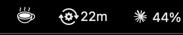
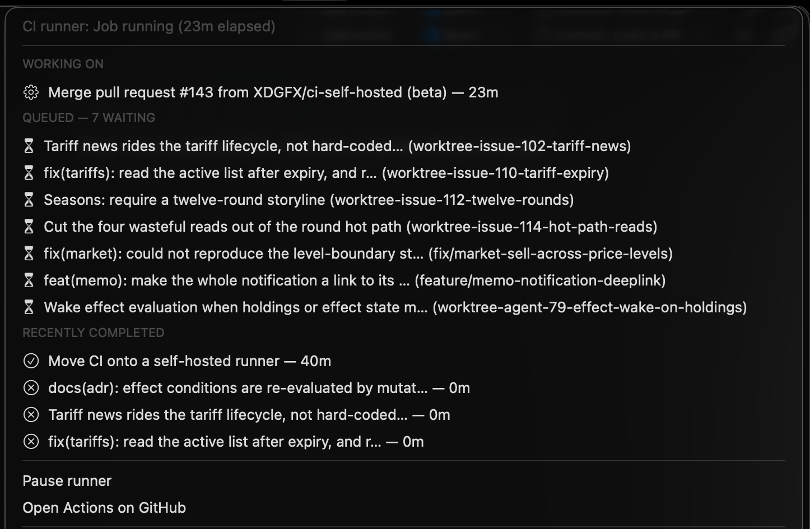

# RunnerBar

A [SwiftBar](https://github.com/swiftbar/SwiftBar) plugin that puts a
self-hosted GitHub Actions runner in the macOS menu bar — and keeps it off
your battery.



Running your own runner is the free-tier escape hatch for private repos, but
the stock installation has two gaps on a laptop: it happily burns battery in
the background, and it's invisible — you can't tell whether it's idle,
mid-job, or how much work is queued. RunnerBar is one shell script that closes
both.

## What it does

- **Power policy** — by default the runner service is up on AC power and
  stopped on battery. It never kills a job mid-run (that would fail your CI
  for nothing): a running job finishes, then the next refresh stops the
  service. *Run on battery* in the dropdown overrides this and keeps the
  runner up whatever the power source.
- **Keep-awake** — while a job is executing, a `caffeinate -i` assertion
  pinned to the worker process stops the Mac idle-sleeping mid-job. Without
  it, CPU load alone does not prevent sleep, a sleeping runner drops off
  GitHub, and the job is failed after ten minutes of silence. The assertion
  lives exactly as long as the job: an idle runner lets the machine sleep
  normally, and queued jobs simply wait for the next wake. A closed lid still
  sleeps regardless — clamshell mode outranks assertions. Toggleable in the
  dropdown (*Keep Mac awake during jobs*, on by default); switching it off
  also releases the assertion for a job already running.
- **Menu bar status** — SF Symbol glyphs matching the native menu bar style:
  - 📡 idle, listening for jobs
  - ⚙️ *N*m — job running, with elapsed minutes beside the glyph
  - 🌙 stopped on battery
  - ⏸ paused manually (toggle in the dropdown)
- **The dropdown** — what the runner is working on right now, the queue in
  execution order, and recent runs with their durations. Every line links to
  its run on GitHub.




## Requirements

- macOS with [SwiftBar](https://github.com/swiftbar/SwiftBar)
  (`brew install --cask swiftbar`)
- A self-hosted runner installed the standard way — configured in
  `~/actions-runner` and registered as a launchd service via `./svc.sh install`
- [`gh`](https://cli.github.com), authenticated, for the queue and history
  sections (without it the status and power policy still work)

## Install

```sh
git clone https://github.com/XDGFX/runnerbar.git
cd runnerbar && bash install.sh
```

The script installs SwiftBar if it's missing, wires the plugin in and sets
SwiftBar to start at login. No configuration: runners are discovered from their
launchd plists, and each one's repository and name are read from the `.runner`
file in its install directory.

The plugin is symlinked into a dedicated SwiftBar plugin folder
(`~/.config/swiftbar`, or whichever folder SwiftBar already uses), so
`git pull` updates it in place — restart SwiftBar afterwards to pick the
change up. The clone itself is deliberately not used as the plugin folder:
SwiftBar runs *every* executable file in that folder, so it would try to run
`LICENSE`, `README.md` and the screenshots as plugins as well.

## Multiple runners

Every runner installed on the machine is shown — GitHub binds a self-hosted
runner to one repository (personal accounts don't get org-level runners), so
"multiple repos" means one installed runner each, and RunnerBar picks them all
up automatically. The dropdown gives each runner its own block, headed by its
identity (`Name — owner/repo: state`), with its own queue, history, and pause
control. The menu bar glyph aggregates: elapsed minutes while one job runs, a
job count while several do.

## Dropdown controls

- **Pause runner** (per runner) — stop that runner until resumed, overriding
  everything else.
- **Keep Mac awake during jobs** (global, default: on) — the keep-awake
  assertion described above.
- **Run on battery** (global, default: off) — ignore the power source and
  keep every runner up all the time.
- **Low-power mode** (global, default: off; Apple silicon only) — confine
  runner work to the efficiency cores via `taskpolicy -b`. E-cores use less
  energy per unit of work — not merely less power — so jobs run cooler and
  quieter, but slower. Applies to the job already running as well as future
  ones; switching it off lifts the policy from live processes immediately.
  Hidden on Intel Macs, where there are no efficiency cores to confine to.

Settings persist as flag files — global ones in `~/.config/runnerbar/`,
each pause flag in its runner's own directory — so they survive reboots and
SwiftBar restarts. SwiftBar's own footer rows (About, Run in Terminal, and
friends) are hidden via the plugin's metadata; to also hide SwiftBar's app
icon from the menu bar, untick it in SwiftBar's preferences.

## Notes

- The policy runs on the plugin's 30-second refresh, because launchd has no
  power-source condition. If SwiftBar isn't running, runners stay in
  whatever state they were last left in.
- GitHub deregisters a runner that stays offline for 14 days; on a
  daily-driver laptop that never comes up.

## Support

RunnerBar is free and open source. If it saved you some time, you can
[sponsor me on GitHub](https://github.com/sponsors/XDGFX).

## Licence

MIT.
